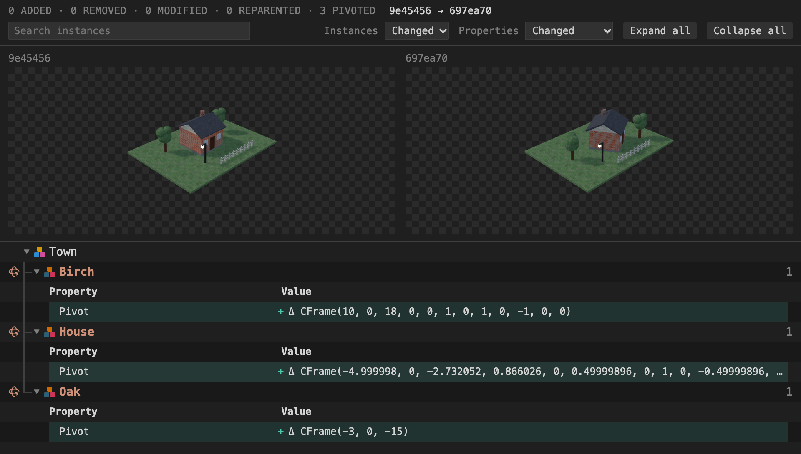
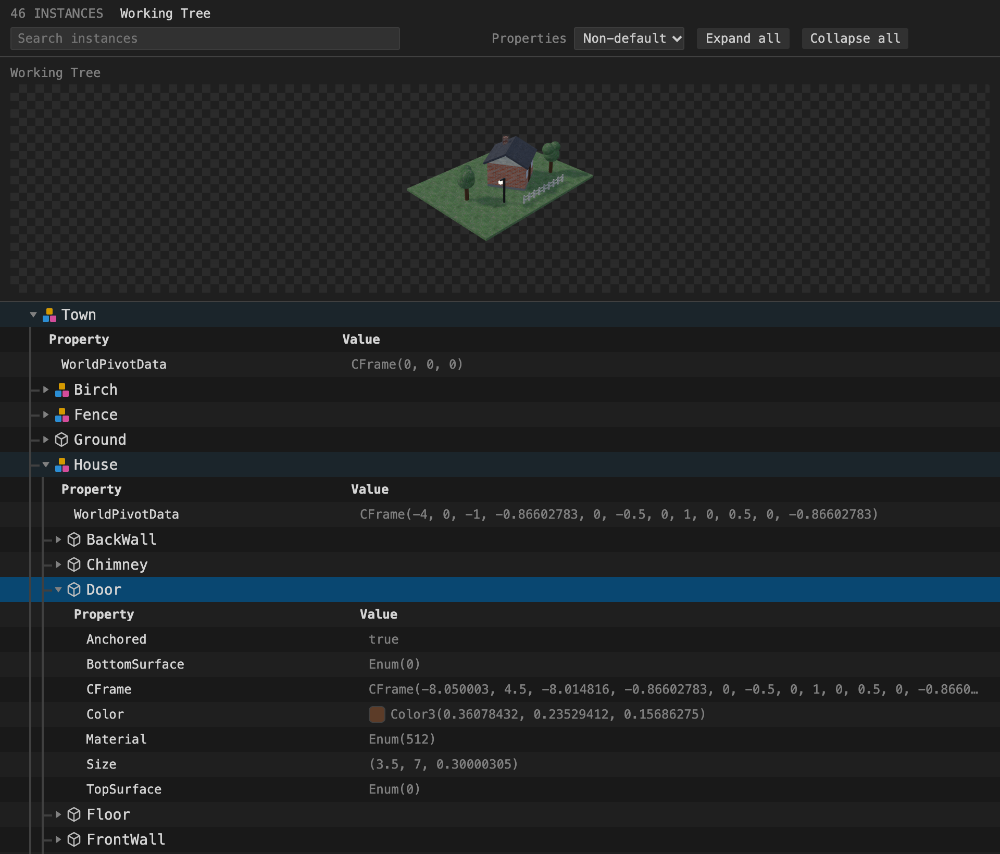
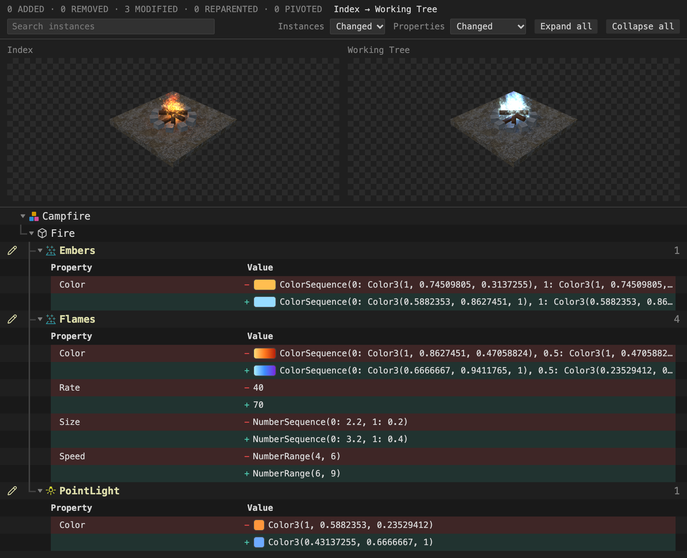
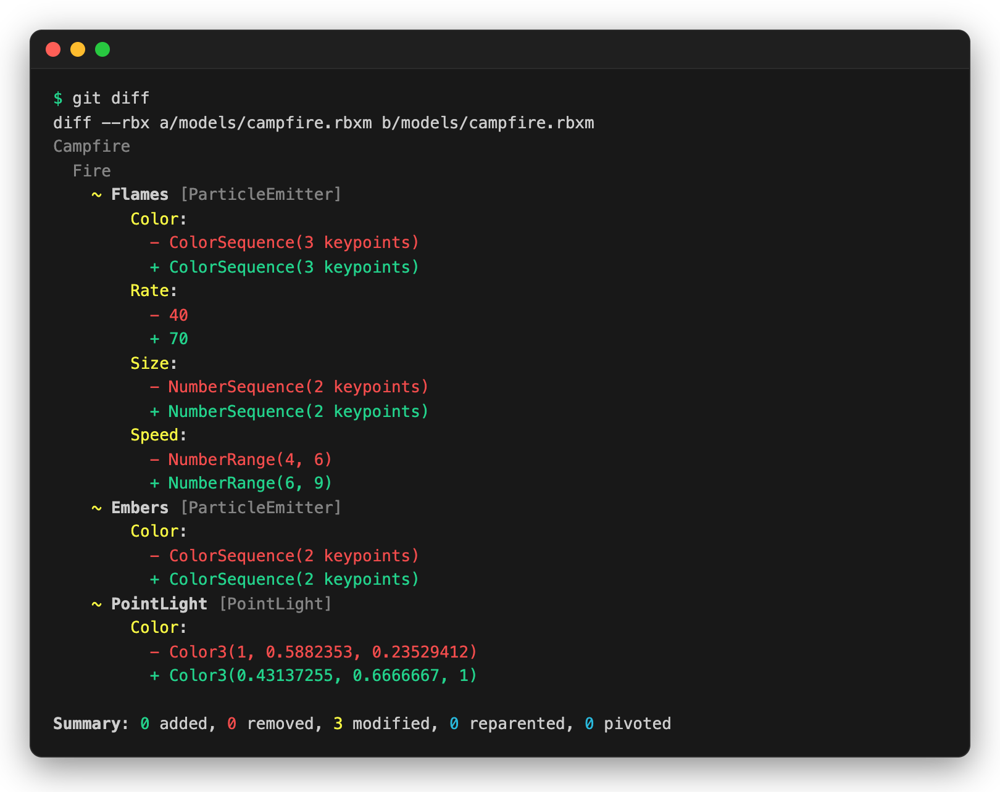
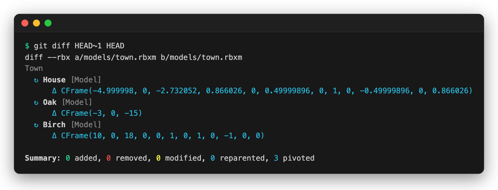
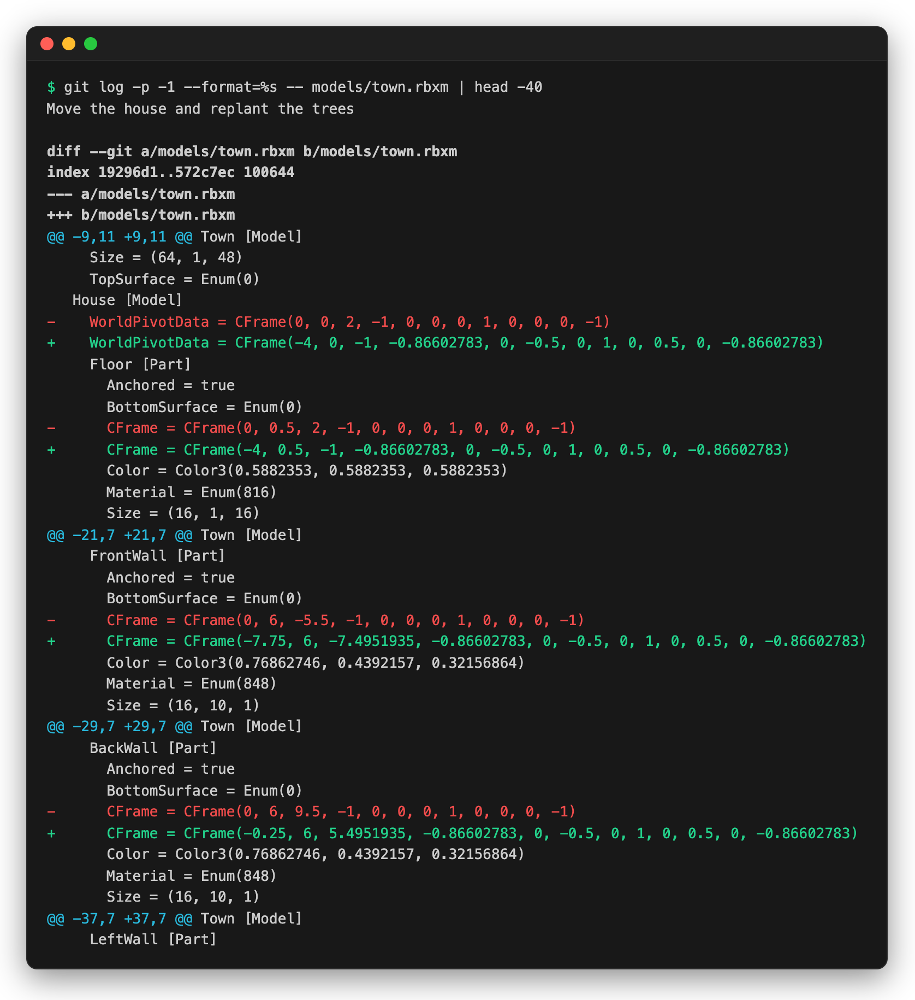

# git-rbx

Semantic diff, three-way merge, and conflict resolution for Roblox place and
model files (`.rbxl`, `.rbxlx`, `.rbxm`, `.rbxmx`), as a git extension.
```
$ git merge feature
Merged in 1.32s: 214 ours + 96 theirs ops applied, 40 deduped, 2 conflicts
CONFLICTS (2):
  ! Workspace.Lobby.Door — property 'CFrame' (base content kept)
  ! Workspace.Props.Crate — delete vs edit (base content kept)
The conflicts are stored inside the file itself (a __GitRbxConflicts folder you will
see in Studio — leave it; resolving removes it). Resolve with:
  git rbx resolve Workspace/map.rbxl --list        (or --studio)
```

## Contents

- [What it looks like](#what-it-looks-like)
- [Install](#install)
- [Quick start](#quick-start)
- [Change types](#change-types)
- [Conflict types](#conflict-types)
- [Commands](#commands)
- [GitHub](#github)
- [Git LFS](#git-lfs)
- [Limitations](#limitations)

## What it looks like

### In the editor

The [git-rbx Viewer](editors/vscode) extension opens Roblox files in VS Code
and its forks. Click a changed `.rbxm` or `.rbxl` in Source Control, the
Graph, or the Timeline to see its diff, or open one from the Explorer to see
the file. With
[roblox-headless-renderer](https://github.com/TabooHarmony/roblox-headless-renderer)
installed, a picture of each version sits above the tree.

**Moved models are pivots.** This commit moved a house and two trees: 24
parts, each with a new CFrame. Each model moved as one rigid body, so the
diff is one pivot per model, with the transform that moved it.



**A file on its own.** Every instance, and the properties it sets.



**A particle edit.** Each changed property's old and new value, with colors
and color sequences drawn as swatches and gradients. The pictures show what
the edit did to the fire.



### In the terminal

`git diff` prints the same changes:





<details>
<summary>The same commit as a line diff</summary>

`git log -p` compares the instance trees that `git rbx show` prints, so it
lists every moved part's CFrame: 54 changed lines in 18 hunks. Pass
`--ext-diff` for the three pivots above.



</details>

## Install

git runs `git rbx <subcommand>` by finding a `git-rbx` binary on your `PATH`.
[Releases](https://github.com/rodeo-rbx/git-rbx/releases) have binaries for
macOS (Apple silicon and Intel), Linux x86_64, and Windows x86_64. With
[mise](https://mise.jdx.dev), add it to your project's `mise.toml` (or
`mise use -g github:rodeo-rbx/git-rbx@latest` for every project):

```toml
[tools]
"github:rodeo-rbx/git-rbx" = "latest"
```

Or build from source. Only the `rbx-dom` submodule is needed (the other one
holds private test fixtures):

```sh
git clone https://github.com/rodeo-rbx/git-rbx
cd git-rbx
git submodule update --init rbx-dom
cargo install --locked --path .
```

Then wire git up. Once per machine:

```sh
git rbx install
```

## Quick start

**See what changed.** `git diff` and `git rbx changes` show instances and
properties, not bytes:

```sh
git diff                              # worktree vs index, semantic for Roblox files
git show HEAD                         # log/show/blame compare readable instance trees
git show --ext-diff HEAD              # … or pass --ext-diff for the semantic differ
git rbx changes main..feature         # every Roblox file changed between two revisions
git rbx diff old.rbxl new.rbxl        # any two files, no git required
git rbx diff old.rbxl new.rbxl --studio   # the same diff in Roblox Studio, in 3D
git difftool -t rbx main..feature     # ditto for every changed file in a range
```

**In Studio.** `--studio` on `diff` or `changes` opens the new version with
every changed instance highlighted by kind, removed content restored as
translucent ghosts where it used to be, and a *changes* panel listing the
diff as a tree. Double click a row to select and frame the instance.
Neither input file is modified. The Studio front ends ship inside the
binary; the only requirement is [rodeo](https://github.com/rodeo-rbx/rodeo)
on `PATH`.

**Merge.** Nothing to do — `git merge`, `git rebase`, and `git cherry-pick`
call the driver. Non-overlapping edits compose; identical edits on both sides
dedupe; only genuinely competing edits become conflicts.

**Resolve.** A conflicted merge leaves the file in your worktree with the
conflict state stamped into it. Pick a route:

```sh
git rbx resolve map.rbxl --studio                       # visual: Ours/Theirs/Custom in Studio
git rbx resolve map.rbxl --list                         # or from the CLI …
git rbx resolve map.rbxl --take theirs --entry Conflict_1
git rbx resolve map.rbxl --take ours --path Workspace.Props.Crate
git rbx resolve map.rbxl --finalize                     # apply choices, strip conflict state
git add map.rbxl && git commit
```

`git mergetool` also works: `install` registers git-rbx as a mergetool that
opens the Studio resolver, and as a difftool that opens the Studio diff
viewer. `git rbx check <file>` exits nonzero while a
file still carries conflict state, which is what the optional pre-commit
hook enforces.

## Change types

Every diff — `diff`, `changes`, `git diff`, and the conflict reports — is
expressed in five kinds of change. Each entry is one primitive operation;
an instance that was reparented *and* edited appears as one Reparented
entry plus one Modified entry, never a blended record.

| Kind | Meaning |
|---|---|
| **Added** | An instance (with its whole subtree) exists only in the new version. |
| **Removed** | An instance (with its whole subtree) exists only in the old version. |
| **Modified** | The same instance has different property values. A rename is a Modified entry on the `Name` property. |
| **Reparented** | The same instance has a different parent (`old_path` → `path`). |
| **Pivoted** | A Model and its world-space descendants were transformed together as a rigid body. |

## Conflict types

A three-way merge computes two change sets against the common ancestor and
combines them. Changes to different targets compose; identical changes
dedupe; the remainder are conflicts. A conflict never silently picks a side:
the contested instance keeps its *base* content in the merged file, both
competing versions are stored alongside it, and you choose.

| Kind | What happened | Resolution options |
|---|---|---|
| **Property** | Both sides set the same property of the same instance to different values (including `Name`, and per-key `Attributes.<key>`). | `ours`, `theirs`, or `custom` with a value of your own. |
| **PropertyBundle** | Both sides changed properties that only make sense together. The canonical case is a MeshPart's `MeshContent` and `InitialSize`: taking the mesh from one side and the source extent from the other renders the mesh at a wildly wrong scale. | `ours` or `theirs`, applied atomically to the whole bundle. |
| **DeleteVsEdit** | One side deleted a subtree; the other edited inside it, reparented something into it, or reparented something out of it. Reported once per deleted root, however many edits the other side made underneath. | `ours` or `theirs` — the whole branch outcome for that subtree. If the surviving side had reparented edited descendants out before the delete, those *reparent-outs* are preserved with either choice. |
| **ReparentTarget** | Both sides reparented the same instance to different parents (or to destinations that cannot be proven equal across the two branches). | `ours` or `theirs`. |
| **Pivot** | Both sides pivoted the same Model by different transforms. Nested pivots resolve in top-down order. | `ours` or `theirs`; the chosen delta is applied to the whole rigid body. |

**Rigid groups.** When a spatial edit touches many parts that are not under
one Model — a hand-built assembly, say — the same rigid movement can surface
as dozens of CFrame conflicts. These are folded into a *rigid group*
(`Group_N`), shown as one decision with the two candidate deltas, and
resolvable as one: `--take theirs --entry Group_1`.

**What does not conflict.** Two branches making the *same* change dedupe,
including identical additions (and references pointing into each branch's
copy of the identical new content), identical reparents, and both branches
evacuating the same instances out of a container before deleting it.
Different attributes or tags on the same instance compose. Tags never
conflict at all (set semantics).

## Commands

```
git rbx diff <old> <new> [--format pretty|summary|json|markdown] [--max-rows N] [-t] [--studio] [--with-properties]
git rbx changes <base> <head> [--format markdown|json|pretty|summary] [--max-rows N] [--studio]
git rbx merge <base> <ours> <theirs> [--output FILE] [--path REAL_PATH] [--json]
git rbx resolve <file> --list [--json]
git rbx resolve <file> --take ours|theirs (--entry NAME | --path BASE_PATH | --all)
git rbx resolve <file> --take custom --entry NAME --value JSON
git rbx resolve <file> --finalize
git rbx resolve <file> --studio
git rbx check <file> [--json]
git rbx show <file> [--format text|json]
git rbx install [--global|--local] [--no-attributes] [--hooks] [--exe PATH] [--check]
git rbx git-diff <git external-diff arguments>
```

- **`merge`** is the git merge driver (`git-rbx merge %O %A %B --path %P`).
  Git passes extensionless temporary copies; `--path` (git's `%P`) supplies
  the real filename, which decides the output encoding and model-vs-place
  behavior. Without it the encoding is sniffed from the file header. Exit 0
  means clean; exit 1 means conflicts were written into the output.
- **`resolve --take`** records a decision without changing content;
  `--finalize` applies every decision, strips the conflict container and
  tags, and writes a clean file. Studio never serializes the result — all
  writes go through git-rbx, so Studio's own load/save side effects never
  leak into the merge.
- **`resolve --studio`** opens the file in Roblox Studio through
  [rodeo](https://github.com/rodeo-rbx/rodeo) with conflicted instances
  highlighted and an Ours/Theirs/Custom panel. Decisions made there call
  back into the same `--take`/`--finalize` commands; the file on disk is
  the only source of truth, so CLI and Studio resolution can be interleaved.
- **`git-diff`** is the git external-diff entry point; you never call it
  directly.
- Every command that produces a decision has a `--json` form. The conflict
  report lists each conflict with, per side, the exact patch that choosing
  it applies, so an agent can drive a merge end to end without a GUI.
- `diff --format json` and `changes --format json` emit a **diff document**:
  a replayable edit script rather than a list of observations. It carries
  an `old` and `new` manifest (id, parent, name, class for every instance,
  matched instances sharing an id), `ops` (`add` with the full subtree and
  its authored properties, `remove`, `reparent`, `setName`, `setProperty`
  with typed before/after values), and `pivots`. Applying the ops to the
  old version yields the new one.
- **`diff --format json --with-properties`** adds each side's authored,
  non-default properties to the document, keyed by its manifest ids, for
  readers that show unchanged instances next to the changes, such as the
  [editor viewer](editors/vscode). The document itself is unchanged.
- **`show`** prints a file's instances with their authored, non-default
  properties: as an indented tree (`text`), or as JSON listing each
  instance's id, parent, name, class, and properties.
- Both JSON forms add each class's default property values, so a reader can
  show every property without them repeating per instance, and its Content
  and ContentId properties, whose values point at assets.

## GitHub

GitHub cannot render Roblox file diffs, so
[`.github/workflows/roblox-changes.yml`](.github/workflows/roblox-changes.yml)
runs `git rbx changes` on every pull request and posts the result as a
step summary and one comment that later pushes update in place. Copy it
into any repository that stores Roblox files.

## Git LFS

git does not run LFS filters for merge drivers or external diffs, so each
side arrives as a pointer. git-rbx resolves pointers through `git lfs
smudge` on read and writes results back through `git lfs clean`, so the
repository keeps pointers and the worktree gets real content. The managed
`.gitattributes` block must stay below the LFS lines; re-running
`git rbx install` moves it back to the end.

## Limitations

- Identity is heuristic. Rename, reparent, and edit of the same instance in
  one commit is not detected; any two of the three are.
- Studio adds content on load and save (services, a session camera,
  migration attributes), so a fresh Rojo build never diffs clean against a
  Studio save. Compare save with save.
- `git diff` uses the semantic diff automatically. `git log -p`, `git show`,
  and `git blame` don't run external diff drivers, so they compare the
  instance trees `git rbx show` prints (line diffs of text, which see a
  renamed or moved instance as a removal and an addition); pass `--ext-diff`
  to `log` and `show` for the semantic diff.